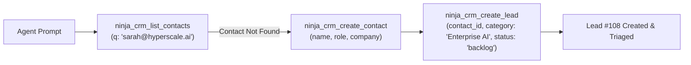
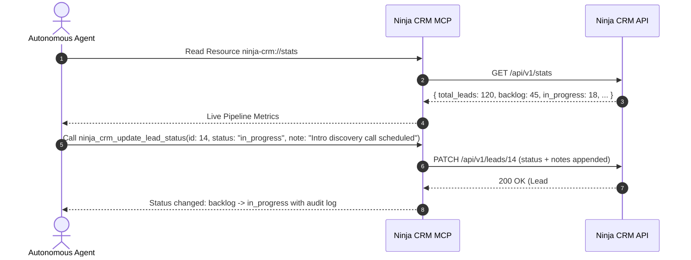
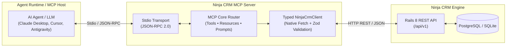

# Ninja CRM MCP Server

[](https://modelcontextprotocol.io)
[](https://www.typescriptlang.org)
[](https://vitest.dev)
[](https://nodejs.org)
[](https://github.com/leouofa/ninja-crm)
[](LICENSE)

Production-grade [Model Context Protocol (MCP)](https://modelcontextprotocol.io/) server that equips autonomous AI agents with full-cycle sales and CRM execution capabilities. Seamlessly connects Claude Desktop, Cursor, Antigravity, and custom agentic runtimes to the Ninja CRM REST API (`/api/v1/`) with strict OpenAPI 3.1 type safety, runtime Zod validation, and zero-overhead stdio JSON-RPC transport.

[Agent Recipes](#-agent-recipes) • [Architecture](#-architecture--system-design) • [Tools & Resources](#-complete-mcp-interface-reference) • [Client Configuration](#-client-configuration) • [Development & Testing](#-local-development--testing)

---

## ⚡ Agent Recipes

Autonomous agents use **Ninja CRM MCP** not just for basic CRUD, but to orchestrate end-to-end sales and customer relationship lifecycles. Below are three primary autonomous workflows ready out-of-the-box:

### 1. Inbound Lead Qualification & Triage

Autonomous SDRs can cross-reference inbound inquiries, avoid duplicate contact creation, verify past company history, and promote contacts to pipeline leads with categorized priority.

```
Agent Prompt:
"Qualify Sarah Lin from HyperScale AI (sarah@hyperscale.ai, VP of Engineering).
Check if we have an existing relationship, create her contact profile if new,
and promote her to our 'Enterprise AI' pipeline in the backlog."
```



* **Tool Sequence**:
  1. `ninja_crm_list_contacts` with `{ q: "sarah@hyperscale.ai" }` to prevent duplicates.
  2. `ninja_crm_create_contact` with `{ name: "Sarah Lin", company: "HyperScale AI", role: "VP of Engineering", email: "sarah@hyperscale.ai" }`.
  3. `ninja_crm_create_lead` with `{ contact_id: 42, new_category_name: "Enterprise AI", status: "backlog" }`.

---

### 2. Personalized Multi-Variable Outreach Drafting

Combines saved CRM category templates with live contact attributes, past interaction history, and custom value propositions—either via single-call deterministic drafting or deep LLM personalization prompts.

```
Agent Prompt:
"Draft a tailored outbound email for Lead #42 using our Fintech template.
Emphasize our new SOC2 compliance certification and maintain a consultative tone."
```

* **Execution Option A (Prompt-driven Synthesis)**:
  * Uses MCP Prompt `ninja_crm_personalize_outreach` with `{ lead_id: "42", tone: "consultative", value_prop_focus: "SOC2 compliance certification" }`.
  * The prompt automatically retrieves the contact background, historical notes, and category outreach template, returning a tailored draft with multiple subject lines.
* **Execution Option B (Deterministic Tool Drafting)**:
  * Uses tool `ninja_crm_draft_outreach` with `{ lead_id: 42, custom_variables: { "focus": "SOC2 compliance" } }`.
  * Automatically resolves all `{{name}}`, `{{company}}`, `{{role}}`, and custom variables into ready-to-send copy.

---

### 3. Automated Pipeline Review & Stage Progression

Inspect real-time pipeline volume via live MCP resources, detect bottlenecked stages, advance lead states, and append immutable timestamped audit logs.

```
Agent Prompt:
"Inspect our active pipeline health. Find leads that have been in 'backlog'
for more than 7 days, advance Lead #14 to 'in_progress', and log that an introductory
discovery call was scheduled for Friday."
```



* **Live Resource**: `ninja-crm://stats` and `ninja-crm://leads/active` provide instantaneous CRM telemetry without LLM tool-call token overhead.
* **Transition Tool**: `ninja_crm_update_lead_status` automatically appends an ISO timestamped entry to the lead's historical notes:
  `[2026-11-20T06:00:00.000Z] Status changed: backlog -> in_progress. Note: Intro discovery call scheduled`.

---

<details>
<summary><b>📐 Architecture & System Design</b></summary>

### Overview



### Engineering Highlights

- **Strict Type Safety**: Fully typed against Ninja CRM's OpenAPI 3.1 specification (`openapi-typescript`).
- **Runtime Validation**: Request parameters and response boundaries guarded with `zod`.
- **Zero-Dependency Stdio Transport**: Standard input/output communication using `@modelcontextprotocol/sdk` ensuring ultra-low latency and compatibility across desktop and CLI agent clients.
- **Dynamic Prompt Synchronization**: Connects to the CRM at startup, converting custom database outreach templates into native, callable MCP Prompts (`ninja_crm_outreach_<category_slug>`).
- **Resilient Error Formatting**: Detailed API error mapping distinguishing validation failures (422), not found errors (404), and upstream network timeouts with actionable diagnostic output.

</details>

---

<details>
<summary><b>🛠 Complete MCP Interface Reference (23 Tools, 5 Resources, Prompts)</b></summary>

### Tools Reference (23 Tools)

| Category | Tool | Description | Key Arguments |
| :--- | :--- | :--- | :--- |
| **Contacts** | `ninja_crm_list_contacts` | Search and paginate contacts | `q`, `sort`, `order`, `limit`, `offset` |
| | `ninja_crm_get_contact` | Retrieve contact with sideloaded lead info | `id` |
| | `ninja_crm_create_contact` | Create new contact profile | `name`, `email`, `company`, `role`, `notes` |
| | `ninja_crm_update_contact` | Update contact metadata | `id`, `name`, `email`, `company`, `role`, `notes` |
| | `ninja_crm_delete_contact` | Delete contact record | `id` |
| **Leads** | `ninja_crm_list_leads` | Filter leads by status, category, or search | `status`, `category_id`, `contact_id`, `q`, `limit` |
| | `ninja_crm_get_lead` | Full lead record with nested contact & category | `id` |
| | `ninja_crm_create_lead` | Promote contact to pipeline lead | `contact_id`, `category_id`, `new_category_name`, `status`, `notes` |
| | `ninja_crm_update_lead` | Update lead status, category, or notes | `id`, `status`, `category_id`, `notes` |
| | `ninja_crm_delete_lead` | Delete lead record (preserves contact) | `id` |
| **Categories** | `ninja_crm_list_categories` | List pipeline categories and template status | `q`, `limit`, `offset` |
| | `ninja_crm_get_category` | Retrieve category by ID | `id` |
| | `ninja_crm_create_category` | Create new pipeline category | `name` |
| | `ninja_crm_update_category` | Rename pipeline category | `id`, `name` |
| | `ninja_crm_delete_category` | Delete category record | `id` |
| **Templates** | `ninja_crm_list_templates` | List outreach templates with category filter | `category_id`, `limit`, `offset` |
| | `ninja_crm_get_template` | Get template body and metadata | `id` |
| | `ninja_crm_create_template` | Create outreach template for category | `body`, `category_id`, `new_category_name` |
| | `ninja_crm_update_template` | Update template body copy | `id`, `body` |
| | `ninja_crm_delete_template` | Remove template | `id` |
| **Workflows** | `ninja_crm_update_lead_status` | Advance lead state with timestamped note | `id`, `status`, `note` |
| | `ninja_crm_draft_outreach` | Resolve variables and generate outreach draft | `lead_id`, `contact_id`, `category_id`, `custom_variables` |
| | `ninja_crm_get_stats` | Compute live aggregate pipeline metrics | _none_ |

### Live Resources (5 URIs)

Read-only, high-speed context feeds accessible without invoking LLM tool calls:

| Resource URI | Description | MIME Type |
| :--- | :--- | :--- |
| `ninja-crm://stats` | Live aggregate metrics: contacts, categories, templates, and leads by stage | `application/json` |
| `ninja-crm://leads/active` | Instant feed of all active pipeline leads (`backlog`, `in_progress`, `done`) | `application/json` |
| `ninja-crm://leads/{status}` | Dynamic template query for any specific stage (`backlog`, `in_progress`, `done`, `archived`) | `application/json` |
| `ninja-crm://categories` | Complete catalog of categories with template coverage status | `application/json` |
| `ninja-crm://templates` | Full library of saved email outreach copy and variable patterns | `application/json` |

### Native Prompts

- `ninja_crm_personalize_outreach`: Multi-perspective email personalization combining contact background, role, category template, and target tone (`consultative`, `direct`, `casual`, `urgent`).
- `ninja_crm_pipeline_review`: Diagnostic prompt that analyzes current CRM conversion rates and highlights stage bottlenecks.
- **Dynamic Category Sync**: At startup, existing CRM category templates are automatically registered as native MCP prompts (e.g. `ninja_crm_outreach_1_enterprise_ai`).

</details>

---

<details>
<summary><b>⚙️ Client Configuration</b></summary>

### Claude Desktop

Add to `claude_desktop_config.json` (`~/Library/Application Support/Claude/claude_desktop_config.json` on macOS):

```json
{
  "mcpServers": {
    "ninja-crm": {
      "command": "node",
      "args": ["/absolute/path/to/ninja-crm-mcp/dist/index.js"],
      "env": {
        "NINJA_CRM_API_URL": "http://localhost:3000"
      }
    }
  }
}
```

### Antigravity / Cursor

Add to your MCP server configuration:

```json
{
  "mcpServers": {
    "ninja-crm": {
      "command": "node",
      "args": ["/absolute/path/to/ninja-crm-mcp/dist/index.js"],
      "env": {
        "NINJA_CRM_API_URL": "http://localhost:3000"
      }
    }
  }
}
```

### CLI Arguments & Environment Flags

```bash
Usage: ninja-crm-mcp [options]

Options:
  -V, --version        Output version number
  -u, --url <url>      Ninja CRM API base URL (env: NINJA_CRM_API_URL, default: http://localhost:3000)
  -k, --api-key <key>  Bearer API Key (env: NINJA_CRM_API_KEY)
  -t, --timeout <ms>   Request timeout in milliseconds (env: NINJA_CRM_TIMEOUT, default: 15000)
  --no-sync            Disable dynamic outreach template synchronization on boot
  -h, --help           Display command options
```

</details>

---

<details>
<summary><b>🧪 Local Development & Testing</b></summary>

### Prerequisites

- **Node.js**: `v18.0.0` or higher
- **Ninja CRM API**: Running locally on `http://localhost:3000` (or configured via `NINJA_CRM_API_URL`)

### Build & Test Suite

```bash
# Install dependencies
npm install

# Run TypeScript compilation
npm run build

# Run static type checking
npm run typecheck

# Run unit and integration test suite with Vitest
npm test

# Regenerate TypeScript definitions directly from OpenAPI spec
npm run typegen
```

</details>

---

## 👤 Author

**Leonid Medovyy**
* GitHub: [@leouofa](https://github.com/leouofa)
* Project Repository: [ninja-crm-mcp](https://github.com/leouofa/ninja-crm-mcp)
* CRM Core Engine: [ninja-crm](https://github.com/leouofa/ninja-crm)

## 📄 License

This project is licensed under the [MIT License](LICENSE).
