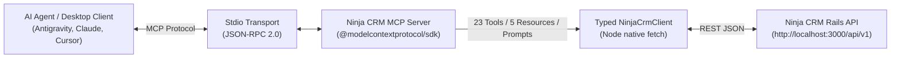

# ninja-crm-mcp

[](https://github.com/leouofa/ninja-crm-mcp)
[](https://modelcontextprotocol.io)
[](https://www.typescriptlang.org)
[](https://nodejs.org)
[](https://github.com/leouofa/ninja-crm)
[](LICENSE)

Official TypeScript-based [Model Context Protocol (MCP)](https://modelcontextprotocol.io/) server for [Ninja CRM](https://github.com/leouofa/ninja-crm), interfacing with the Ninja CRM REST API v1 (`/api/v1/`).

This server empowers AI assistants and autonomous agents (Antigravity, Claude Desktop, Cursor, and custom MCP clients) to manage contacts, qualify leads, navigate pipeline stages, inspect CRM state via live resources, personalize outbound outreach, and execute domain workflows directly against Ninja CRM.

---

## Features

- **Full MCP Capabilities Suite**:
  - **23 Comprehensive Tools**:
    - **Contacts (5)**: `ninja_crm_list_contacts`, `ninja_crm_get_contact`, `ninja_crm_create_contact`, `ninja_crm_update_contact`, `ninja_crm_delete_contact`.
    - **Leads (5)**: `ninja_crm_list_leads`, `ninja_crm_get_lead`, `ninja_crm_create_lead`, `ninja_crm_update_lead`, `ninja_crm_delete_lead`.
    - **Categories (5)**: `ninja_crm_list_categories`, `ninja_crm_get_category`, `ninja_crm_create_category`, `ninja_crm_update_category`, `ninja_crm_delete_category`.
    - **Templates (5)**: `ninja_crm_list_templates`, `ninja_crm_get_template`, `ninja_crm_create_template`, `ninja_crm_update_template`, `ninja_crm_delete_template`.
    - **Domain Workflows (3)**:
      - `ninja_crm_update_lead_status`: Pipeline transitions (`backlog` ➔ `in_progress` ➔ `done` ➔ `archived`) with automatic timestamped activity log appending.
      - `ninja_crm_draft_outreach`: Merges contact metadata, lead history, and category outreach copy with placeholder variable resolution.
      - `ninja_crm_get_stats`: Computes live aggregate CRM statistics and status breakdowns.
  - **5 MCP Resources**:
    - `ninja-crm://stats`: High-level pipeline health and volume metrics.
    - `ninja-crm://leads/active`: Real-time feed of active leads (backlog, in-progress, done).
    - `ninja-crm://leads/{status}`: Parameterized resource view for any pipeline stage.
    - `ninja-crm://categories`: Index of all CRM categories and template statuses.
    - `ninja-crm://templates`: Library of outreach templates.
  - **MCP Prompts & Dynamic Sync**:
    - `ninja_crm_personalize_outreach`: LLM-driven personalization combining template structure with contact background and lead history notes.
    - `ninja_crm_pipeline_review`: Executive pipeline review and bottleneck analysis.
    - **Dynamic Template Sync**: Automatically synchronizes saved category outreach templates into native MCP prompts at startup (e.g. `ninja_crm_outreach_<id>_<category_slug>`).
- **OpenAPI 3.1 Contract**: Fully typed against Ninja CRM's OpenAPI specification with runtime `Zod` validation.
- **Stdio Transport**: Efficient JSON-RPC 2.0 transport over standard input/output with CLI options and environment variable configuration.

---

## Architecture Overview



---

## Quickstart

### Prerequisites

- **Node.js**: `v18.0.0` or higher (tested on Node 22 & 26)
- **Ninja CRM**: Running locally (default: `http://localhost:3000`)

### Installation & Build

```bash
cd /path/to/ninja-crm-mcp
npm install
npm run build
```

Run tests to verify:

```bash
npm test
```

### CLI Options

```bash
Usage: ninja-crm-mcp [options]

Official Model Context Protocol (MCP) server for Ninja CRM REST API v1

Options:
  -V, --version        output the version number
  -u, --url <url>      Ninja CRM API base URL (defaults to NINJA_CRM_API_URL or http://localhost:3000)
  -k, --api-key <key>  Ninja CRM API key / bearer token (defaults to NINJA_CRM_API_KEY)
  -t, --timeout <ms>   Request timeout in milliseconds
  --no-sync            Disable initial outreach template synchronization on startup
  -h, --help           display help for command
```

---

## Configuration

### Antigravity / Cursor Configuration

Add `ninja-crm-mcp` to your MCP configuration (`mcp_config.json`):

```json
{
  "mcpServers": {
    "ninja-crm": {
      "command": "node",
      "args": ["/Users/leonid/src/ninja-crm-mcp/dist/index.js"],
      "env": {
        "NINJA_CRM_API_URL": "http://localhost:3000"
      }
    }
  }
}
```

### Claude Desktop Configuration

In `~/Library/Application Support/Claude/claude_desktop_config.json` (macOS):

```json
{
  "mcpServers": {
    "ninja-crm": {
      "command": "node",
      "args": ["/Users/leonid/src/ninja-crm-mcp/dist/index.js"],
      "env": {
        "NINJA_CRM_API_URL": "http://localhost:3000"
      }
    }
  }
}
```

---

## Tools Index

| Tool Name | Description | Key Parameters |
| :--- | :--- | :--- |
| `ninja_crm_list_contacts` | Search and list contacts | `q`, `sort`, `order`, `limit`, `offset` |
| `ninja_crm_get_contact` | Get contact with sideloaded lead info | `id` |
| `ninja_crm_create_contact` | Create new contact record | `name`, `email`, `company`, `role`, `notes` |
| `ninja_crm_update_contact` | Update contact record | `id`, `name`, `email`, `company`, `role`, `notes` |
| `ninja_crm_delete_contact` | Delete contact | `id` |
| `ninja_crm_list_leads` | Filter leads by status, category, or search | `status`, `category_id`, `contact_id`, `q`, `limit` |
| `ninja_crm_get_lead` | Get lead with nested contact and category | `id` |
| `ninja_crm_create_lead` | Promote contact to lead | `contact_id`, `category_id`, `new_category_name`, `status`, `notes` |
| `ninja_crm_update_lead` | Update lead record | `id`, `status`, `category_id`, `notes` |
| `ninja_crm_delete_lead` | Delete lead (preserves contact) | `id` |
| `ninja_crm_list_categories` | List categories and template presence | `q`, `limit`, `offset` |
| `ninja_crm_get_category` | Retrieve category by ID | `id` |
| `ninja_crm_create_category` | Create new category | `name` |
| `ninja_crm_update_category` | Update category name | `id`, `name` |
| `ninja_crm_delete_category` | Delete category | `id` |
| `ninja_crm_list_templates` | List outreach templates | `category_id`, `limit`, `offset` |
| `ninja_crm_get_template` | Get template body | `id` |
| `ninja_crm_create_template` | Create outreach template | `body`, `category_id`, `new_category_name` |
| `ninja_crm_update_template` | Update template copy | `id`, `body` |
| `ninja_crm_delete_template` | Delete template | `id` |
| `ninja_crm_update_lead_status` | Advance status & append progress note | `id`, `status`, `note` |
| `ninja_crm_draft_outreach` | Draft outreach with merged template | `lead_id`, `contact_id`, `category_id`, `custom_variables` |
| `ninja_crm_get_stats` | Retrieve aggregate pipeline stats | _none_ |

---

## License

MIT © Leonid Medovyy
